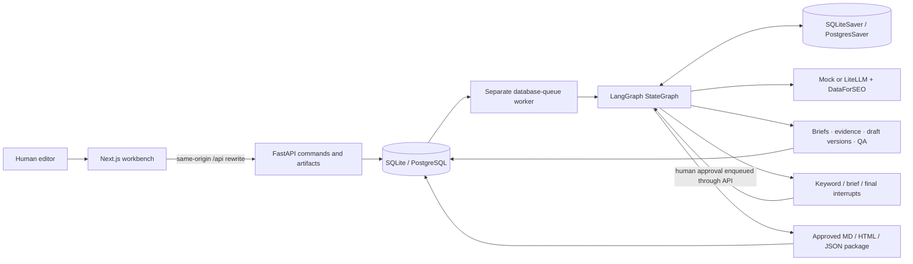

# SEO Content Intelligence

An evidence-led editorial workbench: one keyword becomes one article package, with human approval
of the keyword, brief, and final article. Built with Next.js, FastAPI, SQLAlchemy and LangGraph.

## Quickstart: local SQLite

Requirements: [uv](https://docs.astral.sh/uv/), Python 3.12 (uv can install it), Node 20.9+ and npm.

```sh
make dev
# Another terminal, once API and worker are ready:
make seed
```

Open **http://localhost:3000**. `make seed` creates a project with inventory, a discovery run waiting
at keyword review, and a fully exported example. No API keys are needed. `make dev` starts all three
processes and stops them on Ctrl+C. For separate terminals or a production build:

```sh
cd backend
uv sync --frozen --python 3.12
uv run alembic upgrade head
uv run uvicorn seoci.api.main:app --host 127.0.0.1 --port 8000

# Terminal 2, backend/
uv run python -m seoci.worker

# Terminal 3, frontend/
npm ci
npm run build
npm start -- --port 3000

# Terminal 4, backend/
uv run python seed.py
```

SQLite application data and LangGraph checkpoints are separate files in `backend/data/`; retain both
to resume runs. This is an **unauthenticated, single-operator MVP**: use loopback binding or a trusted
private environment, not an Internet-facing production deployment. No automatic CMS publication exists.

## Quickstart: Docker + PostgreSQL

```sh
docker compose up --build
# Another terminal, after the services are healthy:
docker compose exec api python seed.py
# Or exercise a selected-keyword run using curl:
cd backend && uv run python demo.py

# Stop services, keep PostgreSQL data:
docker compose down
# Remove persisted data too (destructive; only if desired):
# docker compose down -v
```

The stack includes `postgres:16`, API (migrates before starting), a separate worker, and production
Next.js web. API and web ports bind to 127.0.0.1; PostgreSQL is not exposed on the host. Data is retained
in the `pgdata` Docker volume. Do not run local services on ports 8000/3000 at the same time as Compose.
Change the local-only database password before deploying beyond a development environment.

## The workbench

- **Projects:** create/edit voice, language, market, audience, objective and editorial rules; import
  sitemap indexes or URL lists; review known content inventory.
- **New content run:** selected keyword or discovery shortlist. A run always creates one article.
- **Keyword research:** provider-labeled metrics (missing data stays unavailable), timestamped SERP,
  intent override, opportunity dimensions/reasons/confidence, shortlist selection.
- **Content brief:** editable angle, H1/H2/H3 outline and section purposes, questions, source plan,
  exclusions and inventory-based internal links; overlap warnings before writing.
- **Evidence:** source provenance and a claim ledger, with confidence and verification status.
- **Article:** Markdown preview/editor, immutable versions and unified diff; save reruns QA.
- **SEO / QA:** search preview, metadata, image direction, six quality dimensions and actionable findings.
- **Final review:** approve or request revision; YMYL requires explicit expert-review acknowledgment
  and a reviewer comment. MD/HTML/JSON downloads unlock only after approval and worker export.
- **Activity:** audited state changes, usage/cost, job attempts, errors and retry/cancel controls.

Background jobs are polled every two seconds; review gates do not continually poll. Browser requests
use same-origin `/api` rewrites. Configure `BACKEND_URL` **before `next build`**, because rewrite
destinations are included in the production build. Default: `http://127.0.0.1:8000`; Docker builds use
`http://api:8000`. No API keys or provider credentials are sent to the browser.

## Environment and real providers

Mock mode is the default and fully offline. Its long-form Indonesian/English articles have references,
evidence, examples, SEO and QA. Demo results and source limitations are labeled; they are not live-verified
research. Gardening and savings have curated topic-specific examples; other keywords use general
decision guidance. Replace mocks and perform an editorial source check for real publication.

For local runs, set backend environment variables in each backend terminal or `backend/.env`.
For Compose, use an ignored root `.env` (Compose substitutes the values into both API and worker).

| Variable | Default | Purpose |
|---|---|---|
| `DATABASE_URL` | `sqlite:///./data/seoci.db` | Local SQLAlchemy database URL; Compose supplies PostgreSQL automatically |
| `LLM_MODEL` | empty | Empty selects mock. Example real model: `openai/gpt-4o-mini` |
| `OPENAI_API_KEY` | empty | OpenAI credential for an OpenAI model |
| `ANTHROPIC_API_KEY` | empty | Anthropic credential for a Claude model; choose its LiteLLM identifier |
| `SERP_PROVIDER` | `mock` | Set `dataforseo` for live SERP, keyword and research-source discovery |
| `DATAFORSEO_LOGIN` / `DATAFORSEO_PASSWORD` | empty | DataForSEO account credentials |
| `MAX_REVISION_CYCLES` | `2` | Maximum automatic QA revisions |
| `RUN_BUDGET_USD` | `2` | Stop before another model task once recorded spend reaches cap |
| `CACHE_TTL_SECONDS` | `3600` | Local provider cache lifetime |
| `NETWORK_TIMEOUT` | `20` | Backend network timeout seconds |
| `WORKER_POLL_SECONDS` | `0.5` | Worker database queue interval |
| `BACKEND_URL` | `http://127.0.0.1:8000` | Server-side Next.js API proxy destination, set at build time |
| `POSTGRES_PASSWORD` | local development default | Compose database password |
| `API_URL` | `http://127.0.0.1:8000` | Optional API base for the seed script |

Use the normal LiteLLM provider-specific environment variables for other models; add those variables
to Compose's backend environment when using a provider other than the included OpenAI/Anthropic examples.
API credentials remain environment-only. External calls send project context, brief and research data to
the selected providers. Budget enforcement is post-billing: the last call can exceed the remaining cap.

## Architecture



Workers claim PostgreSQL jobs with `FOR UPDATE SKIP LOCKED`; SQLite uses a write lock. Graph thread id
is the run id. Each stage writes version-keyed artifacts and audit events atomically, so committed
artifacts are reused after retry. Approval gates use LangGraph `interrupt()` and `Command(resume=...)`.
Site imports are bounded synchronous connector work; article pipeline work is never performed inline
in an HTTP request. Initial migration and technical state-table extensions are documented in
[backend/README.md](backend/README.md).

## API and development checks

See [the frontend API contract](backend/README.md#frontend-api-contract). Interactive backend docs:
http://localhost:8000/docs. `GET /api/runs/{id}` contains all stage artifacts, typed source/draft/QA
records, job status, audit and usage data. Errors are displayed by the workbench instead of optimistic
fake progress. The UI is keyboard-accessible with labeled forms and a responsive workbench layout.

```sh
make check
# Equivalent:
cd backend && uv run ruff check . && uv run pytest -q
cd ../frontend && npm run lint && npm run typecheck && npm run build
```

GitHub Actions runs the same backend checks and frontend lint/typecheck/build on pushes and PRs.
The acceptance suite is offline: missing metrics, provider timeout/empty response + resume, intent
override, overlap, unsupported numeric claims, YMYL, idempotency, export formatting, manual versions,
revision caps, provider normalization, partial sitemap failures, migrations and complete API/worker E2E.

## GitHub pull requests for Astro blogs

Set `GITHUB_TOKEN` on the backend to a fine-grained GitHub token scoped to the blog
repository with **Contents: read/write** and **Pull requests: read/write** permissions.
The token stays on the server and is never returned to the frontend.
In the project profile, configure `publishing.github_repo` (`owner/name`),
`base_branch` (default `main`), `content_dir` (default `src/content/blog`), and
`file_extension` (`md` only). Raw Markdown is not published as MDX because Markdown
autolinks and other syntax can break MDX builds. Existing projects must apply
`cd backend && uv run alembic upgrade head` before using publishing settings.

After approving the final article and generating exports, click **Kirim PR ke GitHub**.
This creates an Astro-compatible article with YAML frontmatter on a separate
`seoci/` branch and opens a PR for human review. It never pushes to the base branch,
merges, or auto-publishes. Existing files on the base branch are rejected rather
than overwritten. Repeating a successful request returns the saved PR link.
If GitHub fails after creating a branch, inspect that branch/PR before retrying;
an existing branch is reported as a GitHub validation error, not overwritten.

## PRD mapping

| PRD / requirements | Implementation |
|---|---|
| §5 workflow and three human gates | LangGraph checkpointed stages, audited transition function, run stepper and approval UI |
| FR-001–004 project context | Project profile versions/snapshots, sitemap and manual inventory |
| FR-010–016 keyword research | Selected/discovery modes, provenance, intent override, six weighted score dimensions, overlap warnings |
| FR-020–024 strategy / brief | Site fit, editable angle and hierarchical outline, questions/exclusions, source plan and known URLs |
| FR-030–035 research / writing | Untrusted source delimiters, source/evidence records, bilingual demo and LiteLLM writing |
| FR-040–045 SEO / quality | Metadata, image guidance, six QA dimensions, numeric/heading/link/meta/slug/stuffing rules, YMYL and capped revisions |
| FR-050–053 export / versions | Final-approval gate, Markdown/HTML/JSON with stable ids, manual edits and version diff |
| §9 data / §10 reliability | SQLAlchemy entities, Alembic, queue worker, cache/retries, tokens/cost/audit provenance |
| §11 acceptance | Backend pytest matrix, live PostgreSQL Compose walkthrough, browser review-gate checks |

Non-goals and production follow-ups: CMS publishing, multi-tenant authentication, robust egress controls,
fully automated semantic fact verification, strict pre-call token reservation, and complete cross-store
retention tooling. Source verification remains an editorial responsibility; do not mistake mock QA for
professional review or a ranking guarantee.
